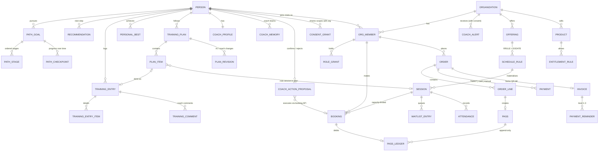

# Data model

Overview from the brief (section 5.5). Kept current as tables are built.

**Built so far (M0):** `job` (background job queue, infrastructure only). None of the entities below exist yet; they arrive from M1.

